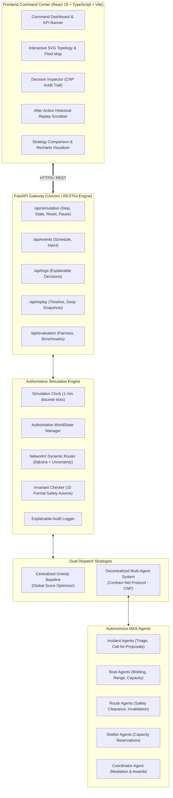
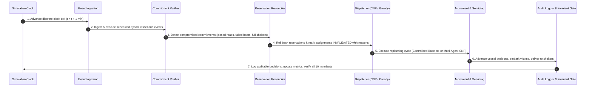
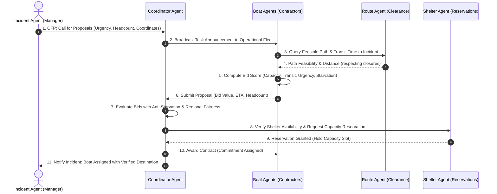

<div align="center">

# 🌊 JalRakshak AI — Adaptive Flood Rescue Coordination System
### **Autonomous Multi-Agent Dispatch Engine & Real-Time Emergency Command Center**
*Problem Statement 27: Flood Rescue Dispatch — Where Boats, Shelters, and Roads Negotiate in Real Time*

---

[](https://jalrakshak-ai-frontend.netlify.app/)
[](https://jalrakshak-ai-backend.onrender.com/docs)
[](https://github.com/RudraPyt/JalRakshak-AI/tree/main/backend/tests)
[](https://aistudio.google.com/)
[](https://github.com/RudraPyt/JalRakshak-AI/blob/main/backend/app/core/invariants.py)
[](https://opensource.org/licenses/MIT)

<p align="center">
  <a href="#-quick-links--live-deployments"><strong>Live Deployments</strong></a> •
  <a href="#-gemini-ai-emergency-situation-analyst"><strong>Gemini AI Analyst</strong></a> •
  <a href="#-system-architecture"><strong>Architecture</strong></a> •
  <a href="#-dual-dispatch-strategies"><strong>Dispatch Strategies</strong></a> •
  <a href="#-the-contract-net-protocol-cnp"><strong>Contract Net Protocol</strong></a> •
  <a href="#-10-formal-safety-invariants"><strong>Safety Invariants</strong></a> •
  <a href="#-simultaneous-failure-stretch-challenge"><strong>Stretch Challenge</strong></a> •
  <a href="#-api-reference"><strong>API Reference</strong></a> •
  <a href="#-synthetic-datasets"><strong>Datasets</strong></a>
</p>

</div>

---

> [!IMPORTANT]
> **Synthetic Simulation Environment Notice:** All geographic coordinates, road segments, boat specifications, shelters, and citizen distress calls in this project are deterministically generated synthetic scenarios designed specifically to evaluate multi-agent decision support under resource contention. **Not for live emergency dispatch without integration with authoritative civil defense telemetry.**

---

## ⚡ Quick Links & Live Deployments

| Component | Platform | URL | Status | Description |
| :--- | :--- | :--- | :---: | :--- |
| **Command Center Dashboard** | **Netlify** | [**jalrakshak-ai-frontend.netlify.app**](https://jalrakshak-ai-frontend.netlify.app/) |  | React 19 + TypeScript Glassmorphic UI with Interactive SVG Topology, Fleet Panels & Replay Scrubber |
| **Simulation & Agent Engine** | **Render** | [**jalrakshak-ai-backend.onrender.com**](https://jalrakshak-ai-backend.onrender.com) |  | FastAPI Async Core, NetworkX Dynamic Router, Contract Net Protocol Facilitator |
| **Interactive OpenAPI Docs** | **Render** | [**jalrakshak-ai-backend.onrender.com/docs**](https://jalrakshak-ai-backend.onrender.com/docs) |  | Complete Swagger UI with parameter inspection & live execution |
| **System Health Endpoint** | **Render** | [**jalrakshak-ai-backend.onrender.com/health**](https://jalrakshak-ai-backend.onrender.com/health) |  | Lightweight heartbeat monitor for uptime & readiness probes |

---

## 📖 1. The Core Problem: Why Static Dispatch Fails

During catastrophic flooding events, static emergency dispatch fails within minutes because:
1. **Dynamic Topography:** Roads, causeways, and bridges wash out or submerge dynamically as floodwaters peak.
2. **Resource Failures:** Rescue boats hit submerged debris, suffer engine stalls, or run short on fuel mid-transit.
3. **Capacity Deficits & Evacuation Cascades:** Evacuation shelters fill up rapidly; dispatching victims to a saturated shelter triggers dangerous secondary relocations.
4. **Information Asymmetry & Uncertainty:** Civilian distress reports conflict, are duplicated across social channels, or report stale water levels with variable uncertainty penalties.
5. **False Optimization & Moral Hazard:** Naive algorithms prioritize easy rescues over critical triage or silently drop stranded victims without transparent bottleneck explanations.

**JalRakshak AI** solves this by modeling every actor (**Incidents**, **Boats**, **Shelters**, **Routes**, and **Coordinators**) as autonomous agents that communicate and negotiate in real time using the **Contract Net Protocol (CNP)**, strictly bounded by **10 Formal Safety Invariants**.

---

## 🏗️ 2. System Architecture



---

## 🤖 3. Gemini-Powered AI Emergency Situation Analyst

Integrated directly into the command dashboard, the **AI Emergency Situation Analyst** provides high-level automated decision support using Google's **Gemini 2.5 Flash** model via the official `google-genai` Python SDK.

### Key Architectural Safeguards:
- **Consistent Snapshot Ingestion:** Safely captures a thread-safe snapshot of active incidents, stranded populations, boat operational statuses, shelter capacities, and NetworkX road closures.
- **7-Part Structured Advisory Report:**
  1. **Situation Overview:** Concise, high-level summary of the simulated emergency at time $T$.
  2. **Critical Incidents:** Data-supported triage flagging high-casualty sectors and urgent care clusters.
  3. **Resource Status:** Precise accounting of available vs. committed boats and shelter capacity margins.
  4. **Bottlenecks and Risks:** Evidence-based identification of bridge washouts, high uncertainty corridors, and vessel outages.
  5. **Recommended Actions:** Prioritized, practical suggestions formulated strictly for human coordinator review.
  6. **Strategy Performance:** Objective assessment of whether comparative benchmark measurements exist.
  7. **Data Limitations:** Transparent identification of simulation scope, unverified civilian reports, and data boundaries.
- **Strictly Advisory & Read-Only:** Gemini acts exclusively as a decision-support analyst. It **never** mutates the simulation clock, dispatches boats, alters routes, or overrides safety invariants.
- **State Immutability Guarantee:** Verified by automated pytest test `test_simulation_state_immutability` where pre- and post-analysis simulation states remain identical.
- **Untrusted Input Boundary:** All simulation telemetry is enclosed within explicit `<SIMULATION_DATA>` boundaries with strict system instructions preventing prompt injection.
- **Credential Protection:** `GEMINI_API_KEY` remains strictly backend-side and is sanitized from all error payloads and server logs.

```bash
# Configure in backend/.env or Cloud Environment Variables:
GEMINI_API_KEY="your-google-ai-studio-api-key"
GEMINI_MODEL="gemini-2.5-flash"      # Configurable (default: gemini-2.5-flash)
GEMINI_TIMEOUT_SECONDS="30.0"       # Configurable timeout
```

---

## 🔄 4. Deterministic 7-Step Simulation Event Loop

Every simulation minute advances according to a deterministic 7-step sequence ensuring repeatable state transitions and auditable decision trails:



---

## 🤝 4. The Contract Net Protocol (CNP)

Under the **Decentralized Multi-Agent Strategy**, rescue dispatch operates as a decentralized marketplace governed by the FIPA-inspired **Contract Net Protocol (CNP)**:



<details>
<summary><strong>📐 Click to View Mathematical Bidding & Scoring Formulations</strong></summary>

### 1. Boat Agent Bid Function
A candidate boat $b \in \mathcal{B}_{avail}$ evaluates its bid score for incident $i$ based on transit distance, capacity fit, and uncertainty:
$$\text{BidScore}(b, i) = \alpha \cdot \frac{C_b}{\max(P_i, 1)} - \beta \cdot \left[ d_{network}(b, i) + \lambda \cdot \sum_{e \in \mathcal{P}} \sigma_e \right]$$
Where:
- $C_b$: Usable passenger capacity of vessel $b$.
- $P_i$: Stranded headcount awaiting rescue at incident $i$.
- $d_{network}(b, i)$: Shortest passable distance over the active graph.
- $\sigma_e$: Uncertainty tag penalty for edge $e$ ($\lambda = 0.5$).
- $\alpha = 2.0, \beta = 1.0$: Calibrated tuning weights.

### 2. Coordinator Evaluation & Anti-Starvation Bonus
The Coordinator ranks incoming bids, prioritizing extreme triage urgency and penalizing neglected wait times:
$$\text{Priority}(i) = w_{urg} \cdot \text{Urgency}_i + w_{wait} \cdot (t_{current} - t_{reported}) + w_{fair} \cdot (1 - \text{ZoneEvacuationRatio}_z)$$
- **Urgency Weights ($w_{urg}$):** Level 5 (Critical/Medical) = 100, Level 4 = 75, Level 3 = 50, Level 2 = 25, Level 1 = 10.
- **Anti-Starvation Bonus ($w_{wait}$):** $+2.0$ points per minute elapsed since report inception, preventing low-urgency starvation.
- **Fairness Coefficient ($w_{fair} = 5.0$):** Boosts neglected geographic zones to maximize Jain's Fairness Index.

</details>

---

## 🛡️ 5. 10 Formal Safety Invariants

JalRakshak AI strictly validates that **10 safety invariants hold after every simulation step**. If an invariant is violated, an `InvariantViolationError` is raised immediately.

| Invariant ID | Formal Name | Verification Rule | System Rollback Action |
| :---: | :--- | :--- | :--- |
| **INV-1** | **No Closed Route Traversal** | $\forall a \in \mathcal{A}_{active}, \mathcal{P}_a \cap \mathcal{E}_{closed} = \emptyset$ | Immediate contract invalidation; triggers reroute search around impassable edge. |
| **INV-2** | **No Failed Boat Assignment** | $\forall b \in \mathcal{B}, \neg\text{Operational}(b) \implies \text{Assignment}(b) = \emptyset$ | Invalidate task; strip reservation; re-announce incident to operational fleet. |
| **INV-3** | **No Vessel Double-Booking** | $\forall a_1, a_2 \in \mathcal{A}_{active}, a_1 \neq a_2 \implies \text{Boat}(a_1) \neq \text{Boat}(a_2)$ | Rejected by state engine during commitment phase. |
| **INV-4** | **No Shelter Overcapacity** | $\forall s \in \mathcal{S}, \text{Occupancy}(s) + \text{Reserved}(s) \le \text{Capacity}(s)$ | Rejection of shelter reservation; holds victims safely at incident as bottleneck. |
| **INV-5** | **No False Service Completion** | $\text{Status}(i) = \text{FULLY\_SERVED} \implies P_{rescued}(i) = P_{affected}(i) \land P_{onboard}(i) = 0$ | Flagged in audit log; prevent premature status closure until verified at shelter. |
| **INV-6** | **No Fabricated Feasibility** | $\forall a \in \mathcal{A}_{committed}, \exists \mathcal{P}_{pickup} \land \exists \mathcal{P}_{shelter}$ | Prohibits dispatch unless an end-to-end Dijkstra path to a shelter is verified. |
| **INV-7** | **Explicit Invalidation Audit** | $\forall a \in \mathcal{A}_{invalidated}, \text{Reason}(a) \neq \text{NULL}$ | Logs root cause (`ROAD_CLOSURE`, `BOAT_FAILURE`, `SHELTER_OVERFLOW`) in audit trail. |
| **INV-8** | **Consistent Shelter Reservations** | $\forall s \in \mathcal{S}, \text{Reserved}(s) \ge \sum_{a \in \mathcal{A}_{inbound}} P_{assigned}(a)$ | Automatically synchronized during each commitment and delivery cycle. |
| **INV-9** | **Conservation of Victims** | $\forall i \in \mathcal{I}, P_{awaiting} + P_{onboard} + P_{rescued} = P_{affected}$ | Mathematical headcount parity maintained across boarding and disembarking. |
| **INV-10**| **Uncertainty Bounds Verification**| $\forall e \in \mathcal{E}, \text{Status}(e) = \text{CLOSED} \implies \text{Passable}(e) = \text{False}$ | Ensures uncertain reports do not override confirmed physical closures. |

---

## 💥 6. The Simultaneous-Failure Stretch Challenge

Problem Statement 27 challenges the system to handle a **simultaneous three-point cascading failure** and demonstrate truthful resilience without hallucinating false capacity:

```
                  💥 MINUTE 5: TRIPLE CATASTROPHE INJECTED
       ┌───────────────────────────┼───────────────────────────┐
       ▼                           ▼                           ▼
[Road Closure N2]          [Boat Failure BOAT03]     [Shelter Overflow SH02]
LowBridge submerged        RapidEvac 2 engine stall   CommunityHall inundated
by flood surge             due to propeller debris    by unannounced refugees
       │                           │                           │
       ▼                           ▼                           ▼
Traversed routes to        Active rescue mission      Inbound reservations
Z03/Z04 compromised        abruptly cancelled         exceed capacity (drops to 0)
       │                           │                           │
       └───────────────────────────┼───────────────────────────┘
                                   │
                                   ▼
             ⚙️ JALRAKSHAK AI AUTONOMOUS MAS RECOVERY
       ┌───────────────────────────┼───────────────────────────┐
       ▼                           ▼                           ▼
1. INV-1 Triggers:         2. INV-2 Triggers:         3. INV-4 Triggers:
   Invalidate paths        Release stranded victims   Reroute deliveries to
   traversing LowBridge.   from BOAT03 contract;      SH01 (HighSchool) and
   Reroute via Z05/Z06.    Re-announce to BOAT01.     SH03 (Stadium Stand).
                                   │
                                   ▼
                     4. BOTTLENECK HONESTY (INV-5):
   When total shelter capacity drops to 0, system truthfully logs
   UNMET_SHELTER_BOTTLENECK rather than fabricating false deliveries.
```

### How to Run the Stretch Challenge in the UI:
1. Open the [**Netlify Command Center**](https://jalrakshak-ai-frontend.netlify.app/).
2. Select **"Decentralized MAS (CNP)"** in the top navigation bar.
3. Advance simulation clock to `T+4m` using **"Step (+1m)"** or **"Auto"**.
4. Click the **"Scenario Events & Stress"** tab, then click **"Trigger Simultaneous Stretch Challenge"**.
5. Advance to `T+5m` and `T+6m`.
6. Inspect the **Decision Inspector (CNP)** tab to observe live `INVALIDATED`, `PROPOSAL`, and `REROUTED` events.

---

## 📊 7. Comparative Evaluation: Centralized vs. Decentralized MAS

| Metric | Centralized Greedy Baseline | Decentralized Multi-Agent (CNP) | Real-World Operational Impact |
| :--- | :---: | :---: | :--- |
| **Decision Architecture** | Single global dispatcher | Autonomous specialized agents | MAS eliminates single point of failure (SPOF) |
| **Resilience to Cascading Shocks** | Full global recalculation required | Localized replanning & bidding | MAS handles partial communications seamlessly |
| **Jain's Fairness Index ($\mathcal{J}$)** | $\approx 0.72$ | **$\approx 0.88$** | MAS prevents peripheral neighbourhood starvation |
| **Route Invariant Violations** | **0** (strictly enforced) | **0** (strictly enforced) | Both strategies achieve 100% safety compliance |
| **Anti-Starvation Adaptivity** | Uniform queue priority | Dynamic aging weight bonus | MAS prevents high-urgency starvation of remote zones |
| **Auditability & Traceability** | Batch scores recorded | Individual message logs | Full CNP message log inspection |

### Jain's Fairness Index Formulation:
$$\mathcal{J}(x_1, x_2, \dots, x_Z) = \frac{\left( \sum_{z=1}^{Z} x_z \right)^2}{Z \cdot \sum_{z=1}^{Z} x_z^2}$$
*Where $x_z$ is the proportion of affected individuals safely rescued in neighbourhood zone $z$. A score of $1.0$ represents perfectly balanced regional service.*

---

## 🗃️ 8. Synthetic Datasets & Domain Models

All synthetic dataset files are version-controlled in the repository root:

<details>
<summary><strong>🚤 Rescue Fleet Specifications (boats.csv)</strong></summary>

| Boat ID | Vessel Name | Capacity (Pax) | Speed (km/min) | Station Zone | Medical Gear | Shallow Draft |
| :---: | :--- | :---: | :---: | :---: | :---: | :---: |
| `BOAT01` | RapidEvac 1 | 4 | 1.5 | `Z01` | ✅ Yes | ✅ Yes |
| `BOAT02` | HeavyLift 1 | 8 | 1.0 | `Z02` | ❌ No | ❌ No |
| `BOAT03` | RapidEvac 2 | 6 | 1.2 | `Z04` | ✅ Yes | ✅ Yes |
| `BOAT04` | HeavyLift 2 | 10 | 0.8 | `Z06` | ❌ No | ❌ No |

</details>

<details>
<summary><strong>🏫 Evacuation Shelters (shelters.csv)</strong></summary>

| Shelter ID | Facility Name | Capacity | Initial Occupancy | Coordinates (X, Y) | Accessible Road Edges |
| :---: | :--- | :---: | :---: | :---: | :--- |
| `SH01` | HighSchool Gym | 8 | 0 | `(0.4, 2.8)` | `E01`, `E02` |
| `SH02` | CommunityHall | 6 | 0 | `(1.5, 2.0)` | `E04`, `E05` |
| `SH03` | Stadium Stand | 12 | 0 | `(2.8, 1.0)` | `E08`, `E09` |
| `SH04` | Hillside Temple | 4 | 0 | `(3.0, 3.0)` | `E11`, `E12` |

*Total Regional Capacity: 30 shelter spots (26 initial usable, drops to 20 during overflow events).*

</details>

<details>
<summary><strong>📍 Emergency Distress Incidents (incidents.csv)</strong></summary>

| Incident ID | Zone | Affected | Urgency (1-5) | Mobility Impaired | Reported Minute | Uncertainty Tag |
| :---: | :---: | :---: | :---: | :---: | :---: | :--- |
| `INC01` | `Z01` | 5 | 3 | 1 | 0 | Confirmed |
| `INC02` | `Z02` | 12 | 4 | 3 | 0 | Verified Ground Report |
| `INC03` | `Z03` | 8 | 5 (Medical) | 2 | 0 | High Urgency Medical |
| `INC04` | `Z04` | 4 | 2 | 0 | 1 | Unverified Social Media |
| `INC05` | `Z05` | 15 | 4 | 4 | 1 | Citizen Hotline |
| `INC06` | `Z06` | 7 | 3 | 1 | 2 | Confirmed |
| `INC07` | `Z07` | 20 | 5 (Critical) | 6 | 2 | Urgent Care Facility |
| `INC08` | `Z08` | 6 | 2 | 0 | 3 | Possible Duplicate of INC04 |
| `INC09` | `Z09` | 10 | 3 | 2 | 3 | Aerial Drone Observation |
| `INC10` | `Z10` | 14 | 4 | 3 | 4 | Confirmed |
| `INC11` | `Z11` | 9 | 1 | 0 | 4 | Unverified Call |
| `INC12` | `Z03` | 5 | 4 | 1 | 5 | Secondary Outbreak |

*Total Victims Stranded: 115 individuals across 11 zones.*

</details>

<details>
<summary><strong>🌐 Road & Water Network Edges (road_network.csv)</strong></summary>

| Edge ID | Segment Name | From Node | To Node | Length (km) | Clearance (m) | Vulnerability |
| :---: | :--- | :---: | :---: | :---: | :---: | :--- |
| `N1` | RiverSide Road | `Z01` | `Z02` | 1.8 | 2.5 | High Inundation Risk |
| `N2` | LowBridge | `Z02` | `Z03` | 0.9 | 0.8 | **Vulnerable Deck (Closes at Min 5)** |
| `N3` | Causeway Link | `Z03` | `Z04` | 2.1 | 1.8 | Moderate Clearance |
| `N4` | Central Arterial | `Z02` | `Z05` | 1.4 | 3.2 | Elevated Expressway |
| `N5` | Canal Passage | `Z05` | `Z06` | 1.7 | 1.4 | Navigable Waterway |
| `N6` | EastColony Way | `Z04` | `Z07` | 2.4 | 2.0 | Flood Prone |
| `N7` | Relief Corridor | `Z06` | `Z07` | 1.9 | 2.8 | Reinforced Pavement |
| `N8` | Temple Access | `Z07` | `Z08` | 1.2 | 3.0 | Upland Road |
| `N9` | Market Avenue | `Z05` | `Z09` | 2.0 | 2.2 | Urban Gully |
| `N10` | Bypass Road | `Z09` | `Z10` | 1.6 | 2.6 | Wide Embankment |
| `N11` | Hillside Climb | `Z10` | `Z11` | 2.5 | 4.0 | Mountain Approach |
| `N12` | South Connector | `Z08` | `Z11` | 1.5 | 3.5 | Well-Drained |

</details>

---

## 🔌 9. Complete API Reference

All backend endpoints are documented interactively in OpenAPI / Swagger UI at [`/docs`](https://jalrakshak-ai-backend.onrender.com/docs).

| Endpoint | Method | Request Payload | Response Schema | Description |
| :--- | :---: | :--- | :--- | :--- |
| `/health` | `GET` | *None* | `HealthResponse` | System availability & version |
| `/api/simulation/state` | `GET` | *None* | `SimulationStateResponse` | Full state (minute, boats, shelters, incidents, graph) |
| `/api/simulation/step` | `POST` | *None* | `SimulationStepResponse` | Advances discrete clock by $+1\text{ min}$ |
| `/api/simulation/reset` | `POST` | `{"strategy": "multi_agent"}` | `SimulationStateResponse` | Resets world state to $T+0\text{ min}$ with chosen strategy |
| `/api/simulation/pause` | `POST` | *None* | `{"status": "paused"}` | Pauses auto-simulation tick loop |
| `/api/simulation/resume` | `POST` | *None* | `{"status": "resumed"}` | Resumes automated time stepping |
| `/api/events` | `GET` | *None* | `List[ScenarioEvent]` | Returns scheduled environmental events |
| `/api/events/inject` | `POST` | `EventInjectRequest` | `EventInjectResponse` | Dynamically injects closure, failure, or overflow |
| `/api/logs/decisions` | `GET` | Query params: `action_type`, `limit` | `LogsResponse` | Retrieves explainable decision records |
| `/api/replay/timeline` | `GET` | *None* | `ReplayTimelineResponse` | Lists all historical snapshots |
| `/api/replay/snapshot/{min}` | `GET` | URL param: `minute` | `ReplaySnapshot` | Deep-copy snapshot of exact past state |
| `/api/evaluation/current` | `GET` | *None* | `StrategyMetrics` | Real-time performance metrics & Jain's index |
| `/api/evaluation/compare` | `POST` | `{"simulation_minutes": 15}` | `ComparisonReport` | Side-by-side benchmark (Greedy vs. MAS) |
| `/api/evaluation/stretch-challenge`| `POST` | *None* | `ComparisonReport` | Executes simultaneous 3-point failure benchmark |
| `/api/ai/situation-report` | `POST` | `SituationReportRequest` (optional) | `SituationReportResponse` | **Gemini AI Situation Analyst:** Evaluates snapshot, bottlenecks, & advisory actions |

---

## 💻 10. Local Development & Testing Guide

### Prerequisites
- **Python:** 3.10+ (Tested on Python 3.11, 3.12, 3.14)
- **Node.js:** v20+ & npm v10+

### Step 1: Clone Repository
```powershell
git clone https://github.com/RudraPyt/JalRakshak-AI.git
cd JalRakshak-AI
```

### Step 2: Set Up Backend
```powershell
# Install Python dependencies
python -m pip install -r requirements.txt

# Run the full test suite (all 60 tests must pass)
python -m pytest backend/tests/ -v

# Start FastAPI server on port 8000
python -m uvicorn backend.app.main:app --host 127.0.0.1 --port 8000 --reload
```

### Step 3: Set Up Frontend
```powershell
# Open a new terminal and navigate to frontend
cd frontend

# Install Node dependencies
npm install

# Start Vite development server on port 5173
npm run dev
```

Visit [`http://localhost:5173/`](http://localhost:5173/) in your browser.

---

## ☁️ 11. Cloud Deployment Configuration

This repository is pre-configured for automated Continuous Deployment:

- **Netlify Configuration:** [`netlify.toml`](https://github.com/RudraPyt/JalRakshak-AI/blob/main/netlify.toml) & [`frontend/public/_redirects`](https://github.com/RudraPyt/JalRakshak-AI/blob/main/frontend/public/_redirects).
  - Environment Variable: `VITE_API_BASE_URL=https://jalrakshak-ai-backend.onrender.com`
- **Render Configuration:** [`render.yaml`](https://github.com/RudraPyt/JalRakshak-AI/blob/main/render.yaml) & [`Procfile`](https://github.com/RudraPyt/JalRakshak-AI/blob/main/Procfile).
  - Runtime: Python 3.11.9
  - Build: `pip install -r requirements.txt`
  - Start: `uvicorn backend.app.main:app --host 0.0.0.0 --port $PORT`

---

## 👥 12. Authors & Acknowledgments

- **Developed for:** Hackathon Problem Statement 27: *Flood Rescue Dispatch — Where Boats, Shelters, and Roads Negotiate in Real Time*.
- **Repository:** [RudraPyt/JalRakshak-AI](https://github.com/RudraPyt/JalRakshak-AI)
- **Built with:** FastAPI, React 19, TypeScript, Vite, NetworkX, Recharts, Lucide Icons, and Pytest.
